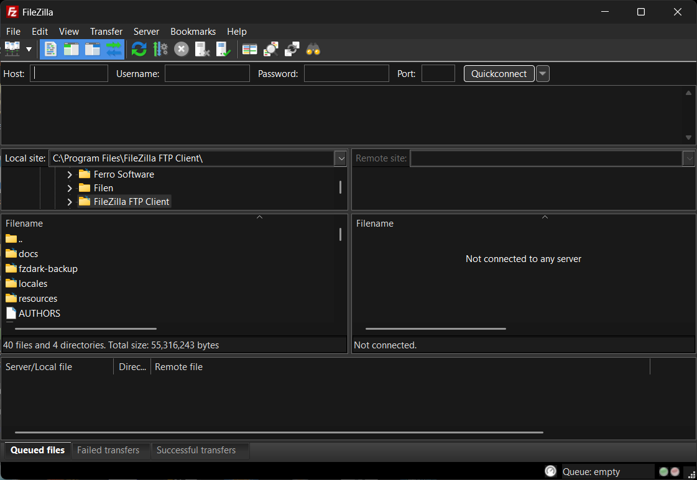

# FileZilla 3.71.1 — Windows light/dark theme build kit



A source-and-scripts kit that builds FileZilla 3.71.1 for Windows x64 with working
system light/dark theme support, plus two ways to apply the result as a drop-in overlay
to a machine that already has FileZilla installed.

Upstream FileZilla does not follow the Windows light/dark setting. This builds it against
wxWidgets 3.3, which does, so FileZilla follows the system appearance by default and
switches live when you change it in Settings → Interface → *Follow the system light and
dark theme*.

**Windows x64 only.** Every script carries a `_win64` suffix for a reason: they drive
MSYS2/UCRT64, autotools and Meson against a Windows-native layout. Nothing here is
portable, and nothing is tested anywhere else.

## The two artefacts

Both are built by default, from the same staged payload, and install **byte-identical
files** — 32 of them: 8 that replace existing files, 24 that are added, none deleted.

| Artefact | Size | Use it when |
|---|---|---|
| `FileZilla-3.71.1-dark-overlay-setup.exe` | ~7.2 MB | Normally. Self-contained installer: detects an existing FileZilla 3.71.1, backs up what it replaces, installs, and registers an uninstaller. No extra tools are needed to *run* it — but FileZilla itself must already be installed, and it needs admin to write to Program Files. |
| `FileZilla-3.71.1-dark-overlay.7z` | ~6.3 MB | You would rather extract files over your existing installation and manage the backup yourself. Also carries the PowerShell installer for a guided, reversible install. |

Each ships with a `.sha256` sidecar in `sha256sum` format so it can be checked after
download.

The overlay must be applied as a unit: the patched `filezilla.exe` needs the exact
wxWidgets 3.3 and libfilezilla build it was compiled against, and mixing it with stock
wx 3.2 fails at load time.

## Layout

    manifests/    SHA-256 of every file in the upstream source tree
    patches/      the 8-patch series for FileZilla, plus .gitignore.baseline
    patches-wx/   the patch series for wxWidgets, plus .gitignore.baseline
    licenses/     licence texts for the components built here
    screenshots/  the screenshot at the top of this file
    scripts/      everything that fetches, patches, builds, packages and tests
    scripts/nsis/ templates for the .exe installer and its removal tool
    tarballs/     offline drop box (see below)
    versions.ps1  every version, URL, pinned digest and fixed path

## Quick start

**1. Bootstrap**, from an elevated PowerShell:

    powershell -File .\scripts\bootstrap_win64.ps1

Installs and hash-verifies Git, MSYS2 and wxWidgets 3.3.3. Re-running is safe;
finished steps are skipped. `-Plan` prints what is missing without installing
anything, and needs no admin.

**2. Build**, in the same shell:

    powershell -File .\scripts\install-filezilla-dark_win64.ps1

Eleven steps: toolchain, dependencies, wxWidgets, libfilezilla/libfzssh, upstream
source, patch series, icon variants, FileZilla, verification, overlay, NSIS installer.
Re-running is cheap — completed steps are detected and skipped.

Or combine them:

    powershell -File .\scripts\bootstrap_win64.ps1 -ThenBuild

| Flag | Effect |
|---|---|
| `-Root <path>` | Put builds, extracts and intermediates somewhere other than `C:\fzdark`. |
| `-Keep` | Keep downloaded archives, extracted trees, build intermediates, logs and the patched work tree. Without it each stage deletes what it fetched once done with it. |
| `-Force` | Rebuild FileZilla and the overlay from scratch. Deliberately does *not* reinstall the MSYS2 toolchain, which needs an elevated shell. |
| `-No7z` | Build only the `.exe`, skipping the `.7z`. The `.exe` is always built either way. |
| `-SkipOverlay` | Skip both overlay artefacts; stop after the FileZilla build. |

Both artefacts are built by default and neither needs anything installed on the
machine that receives it.

Fixed paths, not configurable: `C:\msys64` (toolchain), `C:\wxWidgets-3.3.3` (built in
place), `C:\fzdark\tools\nsis` (portable NSIS, unpacked on demand for the `.exe` build).
NSIS is *unpacked, not installed*: nothing is registered and no elevation is needed.

`C:\fzdark` is only the default, not a requirement — but it is the shortest path that is
free of spaces, so it dodges MAX_PATH trouble in the autotools and MSYS2 layers, and being
outside OneDrive it avoids file-on-demand placeholders turning into phantom build
failures. Any writable path works; `-Root` moves everything except the two fixed tool
installations above.

## Install the overlay

### Route 1 — the installer `.exe`

Run it. It finds your FileZilla, checks the version really is 3.71.1, backs up every
file it replaces into `<FileZilla>\fzdark-backup\`, installs, and adds an entry to
**Add/Remove Programs**. Remove it from there to undo.

It requires administrator rights and will not run without them.

### Route 2 — the `.7z`

**Extract-over**, the simple way: close FileZilla, extract the archive over
`C:\Program Files\FileZilla FTP Client`, choose *replace files*. Nothing else to run.

**With rollback**, extract it anywhere and run:

    .\install-dark-overlay_win64.ps1

Same checks and backup, driven from PowerShell. Undo with the same script plus
`-Uninstall`, which restores the installation byte for byte.

## Things worth knowing before you ship or automate

- **The `.exe` is unsigned.** A browser-downloaded copy gets SmartScreen's blue *Windows
  protected your PC* wall; *More info → Run anyway* gets through. A code-signing
  certificate removes it. The installed binaries were checked against Defender with
  current signatures, marked and unmarked as internet downloads, and are clean.
- **Do not trust the exit code of an elevated `.exe`.** When the shell has to spawn an
  elevated child, the child's exit code does not come back through `$LASTEXITCODE` —
  measured, `0` after a refusal that had in fact worked. Use `Start-Process -Wait`, or
  read `%TEMP%\fzdark-overlay-setup.log`, which records what every run did or refused to
  do. Run from an already-elevated prompt and the exit code is reliable.
- **Installing twice is refused, on purpose.** Both installers stop if the overlay is
  already there, before touching a single file, and say which check tripped. This is not
  fussiness: a second install backs up the *already-overlaid* files as though they were the
  originals, and the uninstaller then restores the overlay over itself, buries the genuine
  stock files in an older backup, and deletes the Add/Remove entry regardless — leaving
  dark mode installed with no way to remove it. The refusal is worth heeding; if you have
  somehow got into that state anyway, the message names the way out.
  - The PowerShell installer checks three things: a backup directory, the Add/Remove key,
    and a payload file whose SHA-256 still matches ours. That last one is why it still
    refuses when the backup folder was deleted by hand and the two markers both look clean.
  - The `.exe` checks the backup folder and the Add/Remove key. It cannot hash without a
    plugin this NSIS does not ship.
  - To install over an existing overlay on purpose, pass `-ForceOverAlreadyInstalled`, or
    `/F` to the `.exe`. It stays recoverable: the existing backup is kept, `-Uninstall`
    restores from the **oldest** backup — the one holding the genuine stock files — and
    then removes every backup. Do not delete the backup folder by hand afterwards, or the
    originals go with it.
- **The removal tool is kept, deliberately.** It lives in `%LOCALAPPDATA%\fzdark`
  because a running executable cannot delete itself, so anything left inside the FileZilla
  folder would stop the installation being restored byte for byte. It is about 54 KB and
  can be deleted at any time.
- **If removal cannot restore, it says so instead of claiming success.** With no backup
  left there is no way to tell which files are ours, so nothing is deleted: the tool lists
  the overlay files still on disk and tells you to reinstall FileZilla from the official
  package.
- **Either tool can remove either install.** An overlay installed by the `.exe` is removed
  by the tool that `.exe` placed, and one installed by PowerShell is removed by
  `install-dark-overlay_win64.ps1 -Uninstall`. Each also recognises the other's backup
  layout, so a tree that was installed with one and then the other is still removable.
  Both restore from the **oldest** backup, which holds the genuine originals. Neither tool
  is a substitute for the other at install time - still install with one, or the other.
- **Which FileZilla gets picked** follows: a target this kit installed to before, then
  Program Files, Program Files (x86), `%LOCALAPPDATA%`, `%LOCALAPPDATA%\Programs`. The
  directory page lets you override it. An empty `/D=` is indistinguishable from passing
  none, so a script with an unset variable silently gets auto-detection.

## Elevation

**Nothing here re-launches itself with `RunAs`**, except the `.exe` installer, which asks
for admin via its manifest and simply does not run if you decline. Everything else either
needs admin for a specific reason or none at all.

| Step | Command | Admin? | Why |
|---|---|---|---|
| See what is missing | `bootstrap_win64.ps1 -Plan` | **No** | Read-only probes. |
| Install missing tools | `bootstrap_win64.ps1` | **Yes** | Installs under `Program Files`, unpacks MSYS2 and wxWidgets. |
| MSYS2 packages | `install-toolchain_win64.ps1` | **Yes** | `pacman` refuses to install packages unelevated. |
| Fetch + verify archives | `fetch-deps_win64.ps1` | No | Writes under the build root. |
| Extract dependencies | `extract-deps_win64.ps1` | No | Writes under the build root. |
| Build wxWidgets / libfilezilla / fzssh | `apply-wx-patch_win64.ps1`, `build-wx_win64.ps1`, `build-libfilezilla_win64.sh`, `build-fzssh_win64.ps1` | No | Writes under the build root and `C:\wxWidgets-3.3.3`. |
| Patch + build FileZilla | `install-filezilla-dark_win64.ps1` | **Yes** only while the toolchain needs installing | With the toolchain present it needs no admin. |
| Get a portable NSIS | `get-nsis_win64.ps1` | No | Only for the `.exe` build. Unpacks, never installs. |
| Build the overlay payloads | `build-overlay_win64.ps1`, `build-nsis-installer_win64.ps1` | No | Reads the install tree, writes the build root. |
| **Run the overlay `.exe`** | `FileZilla-...-setup.exe` | **Yes** | Writes into the FileZilla folder. Declines to start without it. |
| Install overlay to `Program Files` | `install-dark-overlay_win64.ps1` | **Yes** | Same. |
| Install overlay to a user-owned copy | `install-dark-overlay_win64.ps1 -InstallDir <path>` | No | Same script, different target. Useful for testing. |

The build root must exist and be writable by your account; creating it needs admin once.

## Source archives: the `tarballs\` drop box

`tarballs\` is an offline drop box. Fetch scripts check it before the network: anything you
put there is used instead of downloading, and is still verified against the pinned
SHA-512 — an archive that does not match is refused, never overwritten. Delete the file to
go back to the network, or use `-Force`. Names and sizes are pinned in `versions.ps1`.

## Test it

    powershell -File .\scripts\test-powershell-compat_win64.ps1
    powershell -File .\scripts\test-wx-patch_win64.ps1
    powershell -File .\scripts\test-overlay_win64.ps1
    powershell -File .\scripts\test-nsis-installer_win64.ps1

Run the first of those before every commit. It needs no admin, no build and no network,
and finishes in about a second. It confirms the repo is compliant with **Windows
PowerShell 5.1**, the shell every supported Windows already has and the only one this kit
requires:

- parses and loads every script under the PowerShell actually running it
- exercises the native-command helpers against commands that warn, fail, and take both a
  hashtable splat and an argv list
- checks TLS 1.2 is enabled, which .NET Framework does not turn on by default
- scans for cmdlets or parameters that 5.1 does not have, a stray `pwsh.exe`, an argument
  list aimed at a script rather than a native tool, a property read chained onto a
  `Get-Command` that can return null, and native stderr merged without the error
  preference being scoped around it

A script can parse perfectly and still fail at run time under 5.1, which is what this
catches.

The second proves the wxWidgets series still works, which is the question a wxWidgets
release asks. `$WxPatchedTree` is checked on every build, but nothing checked that the
series still *applies* — so a release that moved the code patch 0001 touches would have
failed the tree hash on the build machine, hours in, rather than here in about a minute.
It cuts a linked git work tree at the `wx-baseline` tag and checks that:

- both pins in `versions.ps1` are well-formed tree hashes and differ from each other
- `patches-wx\` holds a series and the `.gitignore.baseline` the first run copies in
- the `wx-baseline` tag hashes to `$WxBaselineTree`, so the tree on disk really is the
  audited pristine one
- applying the series to that pristine tree produces exactly `$WxPatchedTree`
- a second run changes nothing and says so — the double-patch guard
- the patched tree carries no `.orig` or `.rej` from a half-succeeded 3-way merge
- a tree that has already been patched and had its `.git` removed is **refused** rather
  than adopted as its own pristine baseline

It needs an extracted and patched `C:\wxWidgets-3.3.3`, which any machine that has built
this kit has. Without one the tree checks report as *skipped* with the reason, never as
passed, so it can sit in the pre-commit suite on a machine that has not built wxWidgets
yet without reporting a false green. `-Keep` leaves the scratch work tree behind for
inspection.

The third runs four phases against real copies of an actual FileZilla 3.71.1
installation: payload extraction, script install, uninstall-and-restore, and a round trip
of the released `.7z`. It asserts the install is restored byte for byte and that nothing
outside the payload is disturbed, `fzstorj.exe` included.

The fourth builds a user-elevation copy of both `.exe` artefacts and round-trips them
against a scratch copy: install, refuse to overwrite a wrong version, refuse cleanly
while FileZilla is running, and removal restoring the whole tree byte for byte. Both need
a stock FileZilla install to copy from; pass `-StockDir` if it is not in
`C:\Program Files\FileZilla FTP Client`.

Neither of the last two needs a built artefact, so they are cheap; but both need a stock
install, so point them at a scratch copy rather than your live one.

Both of those suites execute a real FileZilla to prove the patched build actually starts,
and FileZilla keeps one shared profile per user at `%APPDATA%\FileZilla`. So each suite
**saves that profile and puts it back** when it finishes, including when it fails part way
through — a test run should not be able to change the configuration of the FileZilla you
actually use. If FileZilla is running at the end, the restore is skipped and the backup is
left in place with a message telling you where it is.

If you would rather have no launches at all, pass `-NoLaunch`. The startup checks are then
reported as *skipped* rather than passed, so it cannot silently look like a green run.

## Provenance

The upstream source is fetched by hash, never trusted by filename:

| | |
|---|---|
| Archive | `FileZilla_3.71.1_src.tar.xz`, 3,583,056 bytes |
| SHA-512 | `44c9c9db88053a1b01ee27ebc9968eabff57d2ba6b23ac44ab080e3def9d5206cb4391dd7e0742bbd6189657a48525cfd5347d34ae87b69ccbd78b29e0101fda` |
| Tree | 1320 files, SHA-256 in `manifests/` |

FileZilla's own download page hands out short-lived signed links and returns HTTP 403 from
some networks, so mirrors are tried and the pinned SHA-512 decides which bytes are
acceptable; anything that fails is deleted and the next mirror tried.

NSIS, used only to build the `.exe`, is fetched the same way: pinned to 3.13 by SHA-256,
tried across SourceForge and two third-party mirrors, and unpacked with 7-Zip rather than
installed.

The patch series is checked against a known tree hash, `dc392be8...`, so a silently
mis-applied patch cannot turn into a shipped binary. The wxWidgets series is checked the
same way against `$WxPatchedTree`, which is the wxWidgets counterpart of that value.

## Licensing

This is a modified build. The complete corresponding source is the upstream FileZilla
3.71.1 tarball plus the patch series in `patches\`, together with the upstream wxWidgets
3.3.3 tarball plus the series in `patches-wx\`, which is exactly what the build scripts
consume.

**The combined work is licensed AGPL-3.0**, because `filezilla.exe` links `libfzssh`,
which is AGPL-3.0-only. AGPL-3.0 section 13 permits that linking, and it makes the AGPL
the governing licence for the combined binary. FileZilla's own `COPYING` says GPLv3; that
is not the whole answer for this particular build.

| Component | Version | Licence |
|---|---|---|
| FileZilla | 3.71.1 | GPL-3.0-or-later |
| libfilezilla | 0.57.0 | GPL-2.0-or-later |
| libfzssh | 1.4.0 | **AGPL-3.0-only** |
| wxWidgets | 3.3.3 | wxWindows Library Licence |
| Boost | 1.88.0 | BSL-1.0 |
| SQLite (amalgamation) | 3530400 | public domain |

Licence texts covering the components built here are in `licenses\` and ship inside the
`.7z`. If you redistribute a binary built from this kit, offer the corresponding source as
described above.

## The wxWidgets patch series

wxWidgets 3.3.3 is not used as shipped. One fix is applied to it, in `patches-wx\`, and it is
the difference between dark mode mostly working and dark mode visibly broken:

| | |
|---|---|
| 0001 | resolve `WM_DRAWITEM` to the right control by HWND instead of by ID |

Under dark mode `wxCheckBox` and `wxRadioButton` become owner-drawn controls, so Windows asks
the parent window to paint them. `wxWindowMSW::MSWOnDrawItem` found the control to paint with
`FindItem(id)`, and `wxControl::MSWFindItem` matches on the ID while ignoring the HWND the
notification also carries. Any two children sharing an ID therefore collide: the first one
created answers for the other, and since Windows never falls back to painting an owner-drawn
control itself, the control that asked to be drawn is left with its space reserved and nothing
in it at all. Sharing an ID is not an application error — `wxID_HIGHEST`, which wx exports as
`nullID`, is the idiomatic "this ID is never used" — so this hits ordinary code. Patch 0001
looks the control up by the HWND from the notification and falls back to the ID, which is
what `HandleCtlColor` already does for `WM_CTLCOLOR*`.

What you see without it: the *Unknown host key* dialog with no *Always trust this host* check
box, *Already connected* with neither of its options, and most of the check boxes and radio
buttons on the Settings pages blank while still taking up space.

**wxWidgets is patched in place, at `C:\wxWidgets-3.3.3`, not copied to a work tree first.**
There is no alternative: `build\msw\makefile.gcc` and the generated `setup.h` under
`lib\gcc_dll\mswu` resolve everything relative to the source root they sit in, and
`build-filezilla_win64.sh` links against import libraries from that same tree. So
`apply-wx-patch_win64.ps1` turns the unpacked tree into a git repository there — one baseline
commit of the pristine sources, then the series — and checks the result against
`$WxPatchedTree` in `versions.ps1`, exactly as step 6 does for FileZilla. It is idempotent, it
rolls back an interrupted `git am`, it refuses a dirty source tree rather than compiling it,
and `-Reset` returns to the pristine baseline commit and re-applies. `build-wx_win64.ps1` runs
it before every build, so an unpatched wxWidgets cannot be compiled by accident. The patch
stays applied; nothing ever reverts the tree, because `filezilla.exe` is linked against the
import libraries in that same `lib\gcc_dll`.

The tree is checked twice, not once, and the second check is the interesting one.
`$WxPatchedTree` is compared *before* applying — if it already matches, the series is not
re-applied, which is the double-patch guard. `$WxBaselineTree` is the hash of the *pristine*
tree and is compared on every run, which is what makes the first run trustworthy. wxWidgets
has no per-file manifest like `manifests\filezilla-<ver>.sources.sha256`: its tarball is
checked once against `$WxSha512` at fetch time, and after that whatever is on disk is what
gets built. Without the baseline pin, a tree that had already been patched — or edited by
hand before the first run — would simply be adopted as "pristine" and the series applied on
top of it, and the wrong answer would look like success. With it, that case is refused and
told how to recover.

Editing `patches-wx\` changes `$WxPatchedTree`, and the already-built wxWidgets no longer
matches it. Rebuild with `-Force`.

## When FileZilla releases a new version

Four pins are specific to one release and cannot be carried across by editing a number: the
per-file manifest under `manifests\`, and `$FzPatchedTree`, `$WxBaselineTree` and
`$WxPatchedTree` in `versions.ps1`. A tree hash changes whenever upstream moves *and*
whenever any patch is edited, so it has to be recomputed rather than guessed.

```powershell
# against an extracted upstream tree for the new version:
.\scripts\update-version_win64.ps1 -Version 3.72.0
```

That hashes the new tree into `manifests\filezilla-3.72.0.sources.sha256`, applies the whole
series to a scratch work tree with `git am -3`, and prints the new values. It does **not**
edit `versions.ps1`, because that file is the audited record of what was verified; it should
only change once someone has read the diff.

It handles the wxWidgets series in the same run, because otherwise two of the four pins would
go unmentioned. wxWidgets moves separately from FileZilla, so the two cases are:

- **A FileZilla release alone** — the usual case. wxWidgets is unaffected, so the script says
  so and prints `$WxBaselineTree` and `$WxPatchedTree` unchanged, pointing at
  `test-wx-patch_win64.ps1` as the way to prove they still hold. Nothing to do.
- **Both at once** — pass `-WxVersion` as well. The new wxWidgets sources have to be
  extracted to `C:\wxWidgets-3.3.3` first (`fetch-deps_win64.ps1` then
  `extract-deps_win64.ps1`, which is what verifies the tarball against `$WxSha512`). The
  script then reads the version out of `include\wx\version.h` in the tree, and **refuses** if
  that is not the version you asked for — otherwise it would print the old version's hashes
  under the new version's name, and you would paste them. When the tree does match, the
  series is re-applied with `-Repin`, which reports the two new hashes instead of enforcing
  the old pins, because that is what a deliberate bump looks like.

  ```powershell
  .\scripts\update-version_win64.ps1 -Version 3.72.0 -WxVersion 3.3.4
  ```

Read the output in this order:

1. **`RESULT:` and the exit code.** The script exits non-zero if the FileZilla series did not
   apply, or if a requested wxWidgets bump did not happen — so a refused bump cannot pass for
   a clean run.

2. **Any patch reported as `FAILED`.** The script stops at the first one, so later patches
   are untested. Resolve it in the work tree it leaves behind:
   ```
   git -C C:\fzdark\work\port-3.72.0 am --show-current-patch=diff
   ```
   Most often upstream edited the code the patch touches, or fixed the problem itself and
   the patch should be dropped. Then `git am --continue`, or `--abort` to start over.

3. **`git diff <baseline>..HEAD --stat`.** Patches can apply cleanly and still be wrong —
   a 3-way merge resolves context drift without anyone noticing the logic no longer fits.

4. **Paste the printed values** into `versions.ps1`: `$FzVersion`, `$FzManifestFile` and
   `$FzPatchedTree`, plus `$FzSourceFile`, `$FzSourceSize` and `$FzSourceSha512`, which come
   from the download page and cannot be derived. The two wxWidgets pins are printed too,
   unchanged or new as described above.

5. **Run both suites**, which between them cover every script's 5.1 compliance and the state
   of both patch series:
   ```powershell
   .\scripts\test-powershell-compat_win64.ps1
   .\scripts\test-wx-patch_win64.ps1
   ```

6. **Rebuild.** Step 6 compares the patched FileZilla tree against `$FzPatchedTree` and
   refuses to continue on a mismatch, and `build-wx_win64.ps1` refuses to compile a wxWidgets
   tree that is not `$WxPatchedTree`. A stale pin fails loudly rather than shipping silently.

The `-3` flag is what makes most bumps routine: every patch carries git blob hashes, so a hunk
whose surrounding lines merely *moved* merges instead of failing. The version that breaks this
way is one where upstream rewrote the lines a patch depends on, which is exactly when you
should look.

## What the patches do

| | |
|---|---|
| 0001, 0002 | let `configure.ac` accept wxWidgets 3.3 and link system pugixml |
| 0003, 0006 | keep MSYS2 and autoreconf scratch output out of the tree |
| 0004 | build against wxWidgets 3.3 |
| 0005 | fix a `std::wstring` narrowing bug that wx 3.3 exposes |
| 0007 | follow the system light/dark theme |
| 0008 | add the 13 light-appearance icon variants |

Nothing in this series works around dark mode painting bugs. That was patch 0009's job
before the wxWidgets fix below made it unnecessary, and it has been dropped: giving a
control a distinct ID only papers over the fact that wx was resolving `WM_DRAWITEM` to
the wrong control in the first place, and it would have had to be repeated for every
dialog. `$FzPatchedTree` was recomputed accordingly.

The wxWidgets series in `patches-wx\` is documented above; it is separate because it is
applied to a different component, in a different place, with its own audited tree hash.
